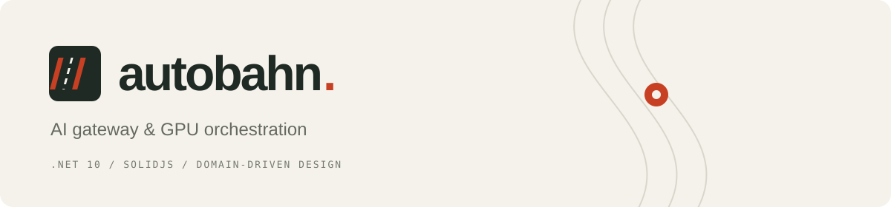
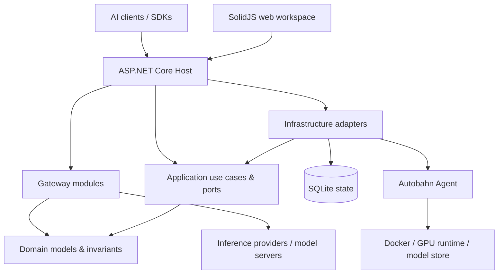

<p align="center"></p>

<p align="center">
  <a href="https://github.com/mohammadrezaabp/Autobahn/actions/workflows/ci.yml"></a>
  <a href="https://github.com/mohammadrezaabp/Autobahn/actions/workflows/security.yml"></a>
  
  
</p>

**Autobahn is a self-hosted AI gateway and GPU management platform.** Route inference requests, manage tenants and API keys, track usage and cost, and operate models across GPU hosts from one web workspace.

Built with **.NET 10**, **ASP.NET Core**, **SolidJS** and **SQLite**, with domain-driven design and enforced module boundaries.

[Quick start](#quick-start) · [Architecture](#architecture) · [Configuration](docs/configuration.md) · [Deployment](docs/deployment.md) · [Security](SECURITY.md) · [Contributing](CONTRIBUTING.md)

## What it does

| Area | Capabilities |
| --- | --- |
| Gateway | OpenAI-compatible chat, completions, embeddings and model discovery; SSE streaming; aliases and upstream model rewriting |
| Routing | Multiple backends, context-aware selection, health probes, primary/standby routing, circuit breakers and bulkheads |
| Access | Hashed API keys, operator and tenant-admin roles, tenant isolation, model grants and provider policies |
| Policy | Request/token limits, concurrency controls, schedules, quotas, budgets and adaptive admission |
| Usage & cost | Usage capture, price cards, rollups, forecasts, reconciliation, exports and signed webhooks |
| Compute | Host availability, GPU memory and utilization, temperature, power, processes and history |
| Models | Model-store scans, guarded deletion, Hugging Face discovery and revision-pinned downloads |
| Deployments | Image/GPU/port policies, dry runs, reviewed changes, startup verification and gateway route synchronization |
| Operations | Structured logs, request IDs, audit records, Prometheus/OpenTelemetry metrics, dashboards and backups |

The sidebar groups **Workspace**, **Gateway**, **Compute**, **Access** and **Operations**. GPUs, Models, Downloads and Activity open inside the same workspace and use the shared sign-in.

## Quick start

### Prerequisites

- [.NET 10 SDK](https://dotnet.microsoft.com/download/dotnet/10.0), matching `global.json`.
- [Node.js 22](https://nodejs.org/) or newer, and [PowerShell 7](https://github.com/PowerShell/PowerShell).
- Docker and NVIDIA tooling only for GPU-backed model serving.

```powershell
git clone https://github.com/mohammadrezaabp/Autobahn.git
cd Autobahn
./scripts/Start-Local.ps1
```

The script generates random local credentials in the ignored `.env` file, builds the web workspace and starts the host. Open **[localhost:8080/admin/](http://127.0.0.1:8080/admin/)** and sign in with `AUTOBAHN_ADMIN_KEY` from your local `.env`.

A fresh install has no model routes or GPU hosts. Under **Gateway → Routing**, register an upstream and wait for its health check. Create an inference key under **Access → API keys** and grant the intended model access. Configure a GPU agent to use the **Compute** pages.

```bash
# Set AUTOBAHN_INFERENCE_KEY to your own issued inference key.
curl http://127.0.0.1:8080/v1/chat/completions \
  -H "Authorization: Bearer ${AUTOBAHN_INFERENCE_KEY}" \
  -H "Content-Type: application/json" \
  -d '{"model":"your-model-id","messages":[{"role":"user","content":"Hello"}],"stream":true}'
```

Keep local secrets out of Git. `.env.example` lists the required variable names without values. Test keys in test fixtures are synthetic and must never be used for a deployment.

### Docker

```powershell
./scripts/Initialize.ps1
docker compose up --build -d
# Optional monitoring:
docker compose --profile observability up --build -d
```

The gateway binds to loopback port **8080**. Optional Prometheus and Grafana bind to loopback **9090** and **3000**. State lives in named volumes. Before remote access, configure HTTPS, trusted proxies, network boundaries and backups as described in [deployment](docs/deployment.md) and [security](docs/security.md).

## Architecture

Autobahn is a **modular monolith** with an independent GPU agent. The inference data plane and fleet control plane share one host; application use cases coordinate domain rules through ports, and adapters implement persistence and external operations.



| Layer | Responsibility |
| --- | --- |
| `Autobahn.Domain` | Framework-independent business models, grants, pricing and fleet state machines |
| `Autobahn.Application` | Use cases, ports, planning and deployment orchestration; depends only on Domain |
| `Autobahn.Infrastructure` | Agent communication, durable fleet state, host processes, transfers and Git integration |
| Gateway modules | API transport, streaming proxy, security, policy, billing, registry, persistence and observability |
| `Autobahn.Host` | Composition, configuration, HTTP middleware, authorization and workspace assets |
| `Autobahn.Agent` | Authenticated host service for GPU status, model storage, downloads and model servers |

**Invariants live in domain models.** Deployment plans reject stale inventory and allocation conflicts. Downloads enforce legal state transitions and monotonic progress. Model paths reject traversal and links; deletion checks serving models and active transfers.

Every public C# type has its own file. Architecture tests enforce dependency direction; the layout tool checks type/file conventions. Read [the architecture guide](docs/architecture.md) for module boundaries, consistency and deployment flows.

## Development & tests

```powershell
# Install dependencies, typecheck and test both web applications,
# build .NET, check public-type layout, and run the .NET tests:
./scripts/Test.ps1

# Browser tests, after building the host and both frontends:
cd src/Autobahn.Admin.Web
npx playwright install chromium
npm run test:e2e
```

Build web assets in order: **Admin.Web**, then **Fleet.Web**. The gateway bundles the compute components; the fleet entry preserves saved URLs and hosts the configuration guide. Neither generated bundle is committed.

CI runs frontend tests and dependency audits, .NET unit/integration/architecture tests, browser flows, a full-history secret scan and CodeQL. Test credentials and state are isolated from local development. GPU integration needs a configured test host; unit tests cannot establish model/image compatibility or actual host throughput.

## Documentation

| Guide | Contents |
| --- | --- |
| [Architecture](docs/architecture.md) | Modules, dependency rules, state transitions and deployment flow |
| [Configuration](docs/configuration.md) | Gateway, fleet, agents, secrets and monitoring |
| [Deployment](docs/deployment.md) | Docker, GPU hosts, networking and persistence |
| [Verification](docs/verification.md) | Automated checks and hardware validation |
| [Security model](docs/security.md) | Trust boundaries, authorization and operating requirements |
| [Security policy](SECURITY.md) | Private vulnerability reporting and supported versions |
| [Contributing](CONTRIBUTING.md) | Local workflow, conventions and pull requests |

## Project ownership

Maintained by [Mohammad Reza Abbaspour](https://github.com/mohammadrezaabp). Contributions are welcome through pull requests. Direct updates to `main` are reserved for the repository owner.
