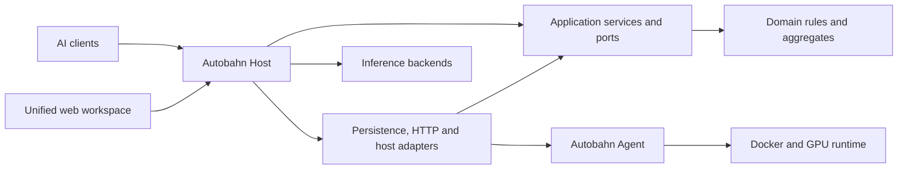

# Architecture

Autobahn combines an inference data plane and a fleet control plane in one ASP.NET Core host. Fleet agents are independent .NET services on inference hosts.

## Project boundaries

| Project | Responsibility |
|---|---|
| `Autobahn.Domain` | Pure business models, grants, pricing, rate-limit policies, fleet specifications, deployment and download state machines |
| `Autobahn.Application` | Use cases, repository/service ports, fleet planning, reviewed deployment orchestration, error mapping and usage transformations |
| `Autobahn.Infrastructure` | Fleet persistence, authenticated agent transport, GitLab adapter, polling, metrics, model-store access, transfers and host process adapters |
| `Autobahn.Host` | ASP.NET composition, gateway middleware ordering, configuration, authorization, fleet sessions and console assets |
| `Autobahn.Agent` | Authenticated node HTTP service for host status, storage, transfers and model servers |
| `Autobahn.Api` | Gateway control and inference-discovery endpoints and their HTTP contracts |
| `Autobahn.Proxy` | Streaming forwarding, routing, backend selection and resilience |
| `Autobahn.Security` | Authentication, tenant/operator authorization, key administration and audit adapters |
| `Autobahn.Policy` | Rate limiting, schedules, quotas, budgets and admission enforcement |
| `Autobahn.Persistence` | EF Core SQLite mappings, repositories, migrations and database maintenance |
| `Autobahn.Registry` | Model-route registry, probes, mutations and encrypted upstream credentials |
| `Autobahn.Billing` | Usage processing, pricing, rollups, forecasts, reconciliation and webhooks |
| `Autobahn.Observability` | Request/error/log stores, metrics and operational summaries |
| `Autobahn.OperatorConsole` | Optional terminal dashboard and commands |

Domain references no project or framework assemblies. Application references Domain only. Adapters depend inward. Architecture tests enforce these rules and the gateway module dependency graph.

## Consistency boundaries

`Deployment` guards state transitions and refuses an outdated inventory revision. Server specifications and host policies guard names, model references, image repositories, GPU sharing, ports and reserved runtime arguments. Plans check desired inventory and current host state.

`DownloadJob` guards state transitions and monotonic progress. Jobs are persisted before work is queued. Completion is published after file sizes and available LFS hashes have been checked. Interrupted jobs can be restarted to resume partial files.

Agent storage changes, server changes and download enqueueing share a mutation gate. Model deletion checks managed servers, active jobs and running container mounts. Paths reject traversal, symlinks and junctions. Downloads run serially per agent with a bounded queue.

## Deployment flow

1. Read inventory and its revision.
2. Validate the proposed aggregate and allocation conflicts.
3. Ask the agent for a dry run.
4. Save a local change request or open a GitLab merge request.
5. Apply explicitly, rechecking inventory and host policy.
6. Remove affected gateway backends, change the server, wait for its model API, then publish its route and encrypted credential.

Local changes persist each completed host operation. Failed deployments remain available for inspection. Removed servers are not automatically restarted. Reconcile actual host state with a new reviewed change. Git-managed inventory uses an exact planned commit for apply.

## Security and storage

Tenant admin keys can view fleet data; only admin keys from the configured operator tenant can mutate it. Fleet sessions are encrypted, HTTP-only, same-site cookies. The underlying key is revalidated on each request, subject to the configured key-validation cache. Writes require a console request header; sign-in is rate limited.

Node tokens are independent from gateway keys and are compared in constant time. Runtime keys are encrypted with ASP.NET Data Protection and passed to Docker through a temporary owner-readable environment file. Inventory and command failures do not expose them.

Gateway data uses EF Core SQLite migrations. Fleet/agent state uses a separate SQLite document store with WAL and parameterized statements. Keep one gateway writer and one agent per model store. Back up databases, encryption keys and secret files together.
